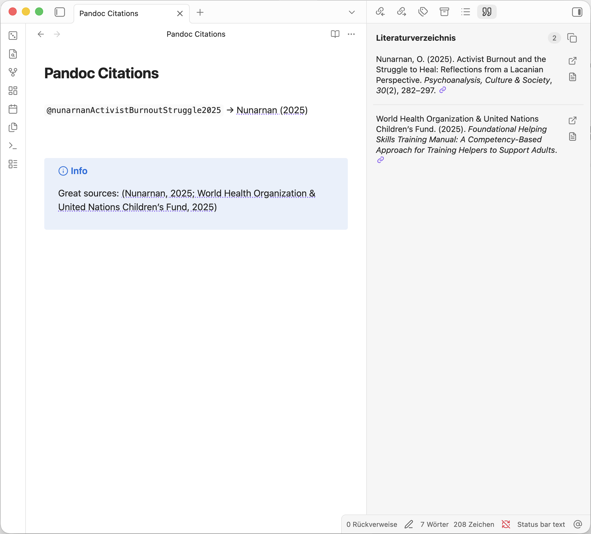

# tillwhat's Obsidian Pandoc Reference List

This fork displays a formatted reference in the sidebar for each pandoc citekey present in the current document.

Setup:
- Ensure [Pandoc](https://pandoc.org/) is installed. **This plugin requires at least version 2.11**.
- Supply a path to a compatible bibliography file or enable Zotero integration. Zotero must be running locally; bibliography
  entries are read through Zotero's local API (which you need to enable in the Zotero settings!) and use its native citation keys.
- Choose a citation style
- Run "Pandoc Reference List: Show reference list" from Obsidian command palette to display References tab in the sidebar, or enable it in the settings




Originally developed by [Matthew Meyers (mgmeyers)](https://github.com/mgmeyers) - thank you so much!

## Development

This fork targets Obsidian 1.13.0 and newer. Install dependencies and run the
usual checks with Node.js 24.21.0 or newer:

```sh
npm ci
npm run check-types
npm run lint
npm test
npm run build
```

## Publishing a new version

Keep the plugin ID and name stable once users have installed the fork. Do not
change `manifest.json.id` for a normal release.

Before publishing, update the version consistently:

1. Choose the next semantic version, such as `0.2.0`.
2. Run `npm version patch --no-git-tag-version` (use `minor` or `major` instead
   when appropriate). This updates `package.json` and `package-lock.json`
   without creating a Git tag.
3. Run `npm run bump`. This updates `manifest.json` and `versions.json` using
   the minimum Obsidian version from `manifest.json`, stages them together with
   `package.json`, and generates `release-notes.md` from commits since the
   previous Git tag.
4. Stage the lockfile and review everything before publishing:

```sh
git add package-lock.json
git diff --staged
npm test -- --runInBand
npm run build
```

Use the same version in `package.json`, `manifest.json`, `package-lock.json`,
and the Git tag. Do not prefix the tag with `v` unless the Obsidian community
listing and release configuration are also changed consistently.

The repository provides `npm run release` for the final commit/tag/push step.
After reviewing the staged files, run:

```sh
npm run release
```

It creates commit and tag `0.2.0`, pushes the branch, and pushes all tags.
Pushing the tag triggers `.github/workflows/release.yml`. The workflow runs
`npm ci`, creates `main.js`, and publishes a GitHub release containing
`main.js`, `manifest.json`, and `styles.css`. The release notes come from
`release-notes.md`. The workflow grants `GITHUB_TOKEN` write access to
repository contents so it can create the release. If GitHub Actions is set to
"Read repository contents and packages" in repository settings, change it to
"Read and write permissions" or retain an explicit contents permission in the
workflow.

You can also publish manually if that script is unsuitable:

```sh
git commit -m "0.2.0"
git tag 0.2.0
git push origin main
git push origin 0.2.0
```
